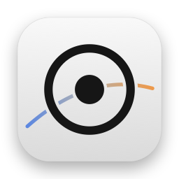

<p align="center">
  
</p>

<h1 align="center">D65</h1>

<p align="center">
  White-point balance for external displays, measured with an iPhone.
</p>

<p align="center">
  <a href="https://github.com/Tinnci/d65/actions/workflows/ci.yml"></a>
  
  
  
  <a href="LICENSE"></a>
</p>

D65 measures a display's white with the iPhone's ambient-light sensor, solves three per-channel
gains, and applies them through the Mac's gamma table. A quality gate refuses any correction that
doesn't measurably help. It isn't a colorimeter replacement or an ICC profiling tool: it moves
white, and says so.

<picture>
  <source media="(prefers-color-scheme: dark)" srcset="docs/images/whitepoint-dark.svg">
  
</picture>

> **Status: experimental.** The Mac app, iPhone probe and CLI share one tested engine, and the full
> flow has run on one display (a HAN K27 over USB-C). The probe's light sensor is uncalibrated, so
> the numbers show convergence against that sensor, not colorimeter accuracy. See
> [status](docs/status.md) and [experiments](docs/experiments.md).

## How it works

1. **Measure.** The Mac shows twelve full-screen patches while the phone lies face-down on an
   outline. Black gives the ambient light; four greys fit the panel's response.
2. **Solve.** The white is compared with D65 using CIEDE2000 at equal luminance. Gains are solved
   in linear light and raised to 1/γ for the encoded table.
3. **Verify and keep.** The correction is applied, white is measured again, and at most three
   passes run. Review shows the result on the real display; Keep hands it to a menu-bar agent that
   holds it, reapplies it when the display returns, and flags it when contrast, preset or mode
   change.

<picture>
  <source media="(prefers-color-scheme: dark)" srcset="docs/images/gamma-dark.svg">
  
</picture>

<picture>
  <source media="(prefers-color-scheme: dark)" srcset="docs/images/primaries-dark.svg">
  
</picture>

The figures are generated from the recorded sessions by `python3 scripts/make-figures.py`.

## Limits worth knowing first

- **Sideload only.** The probe reads the ambient-light sensor through private IOHID calls, so it
  can't ship on the App Store. That reader stays out of this repository (`local/`, git-ignored); a
  clean clone builds a probe that says it has no sensor, or a labelled simulation in the Simulator.
- **One panel so far.** Behaviour on other monitors, connections and HDR is unknown. A
  [monitor report](.github/ISSUE_TEMPLATE/monitor-report.md) helps most.
- **Software correction.** The gamma table only applies while D65 runs, and macOS reverts it when
  D65 quits. Hardware gain over DDC/CI is ignored by the test panel.
- **White only.** A diagonal gain can't fix gamut or tone response.

## Why the name

A white-point correction is defined by its target. Apple's own implementation optimises toward
6504 K, which is D65 to within rounding. Naming the project after the target is honest about the
scope: this moves a display's white, and does not claim to characterise the panel.

It is also deliberately not called *Calibrate*, *Gamut* or *Spectra*. Those names would promise
work this project does not do.

## Quick start

Requires macOS 14+ and a Swift 6 toolchain. The package and CLI build with the Command Line Tools
alone:

```sh
swift build
swift run d65 selftest
swift run d65 gains 0.94 1.00 1.05
swift run d65 display list                                   # find --display-id
swift run d65 display probe                                  # read-only
swift run d65 display apply --r 0.97 --g 0.95 --b 1.0 --hold 10
swift run d65 display reset
swift run d65 serve            # advertise _d65._tcp, solve gains from a probe
swift run d65 ddc probe        # read monitor controls over DDC/CI, with timings
swift run d65 ddc capabilities # the monitor's MCCS capabilities string, parsed
```

`--hold` matters: macOS restores the gamma table as soon as the process that set it exits, so an
un-held `apply` is effectively a no-op. Calibration sessions restore their starting tables when they finish. The Mac app's menu-bar
agent can separately keep and hold an accepted correction.

```
measured   x=0.3144 y=0.3344  CCT≈6382 K
gains      R=0.9721 G=0.9500 B=1.0000  (alpha 1.00)
predicted  x=0.3127 y=0.3290  CCT≈6508 K
ΔE00      3.521  (measured → corrected, relative luminance ×0.958)
```

`swift test` additionally requires a full Xcode installation, because XCTest is not shipped with
the Command Line Tools. CI runs both.

Hardware sessions: the CLI run at `b219ab6` reached normalized ΔE00 **4.56 → 1.40** and the
Mac-app run at `3da5340` **4.18 → 1.69**, each in one pass. See
[experiments §13–14](docs/experiments.md#13-first-real-session-after-the-shared-engine-and-app-changes)
and the [session runbook](docs/runbook.md).

## Documentation

| Document | Contents |
|---|---|
| [docs/runbook.md](docs/runbook.md) | build/install the real probe and reproduce a hardware session |
| [docs/status.md](docs/status.md) | what works, what does not, next steps |
| [docs/implementation.md](docs/implementation.md) | modules, CLI, wire protocol |
| [docs/experiments.md](docs/experiments.md) | every measurement, with numbers |
| [docs/hardware.md](docs/hardware.md) | display, DDC matrix, gamma behaviour |
| [docs/architecture.md](docs/architecture.md) | why the code is split this way |
| [docs/research/](docs/research/) | Apple's Color Balance and the ALS path |

## Layout

```
Sources/D65Core          XYZ, Lab, CIEDE2000, primaries, white-point solver, gains, quality gate
Sources/D65Measurement   measurement model and normalisation
Sources/D65Link          wire protocol and length-prefixed framing
Sources/D65Display       gamma transactions, DDC and mode keys
Sources/D65Calibration   shared session engine, measurements, structured records
Sources/D65MacRuntime    selected screen, patch presenter and Bonjour host
Sources/d65              CLI: selftest, gains, cct, verify
Apps/D65Mac              menu-bar agent and calibration session (SwiftUI)
Apps/D65Probe            iPhone probe (SwiftUI); sensor injected locally
docs/status.md           what works, what does not, next steps
docs/implementation.md   modules, CLI reference, wire protocol
docs/experiments.md      every measurement, with numbers
docs/hardware.md         display, DDC capability matrix, gamma behaviour
docs/architecture.md     module boundaries and data flow
docs/research/           Apple's Color Balance, and how the ALS is read
scripts/                 icon and README-figure generators, revision stamp
project.yml              XcodeGen spec for the two apps
```

## Apps

The app targets are defined in `project.yml` and generated with XcodeGen:

```sh
brew install xcodegen
xcodegen generate
open D65.xcodeproj
```

They need Xcode 16 or later.

- **D65Mac** is a menu-bar agent. It holds each display's kept correction while it runs, reapplies it
  when the display returns, and marks it stale when contrast, preset or display mode changes.
  *Calibrate Display…* opens a five-step session (Prepare, Connect, Place, Measure, Review): the
  phone is placed on a life-size outline, measuring starts when its readings settle, and Review
  previews the result on the real display before you keep or discard it. Esc always cancels, and
  quitting restores every display.
- **D65Probe** is the iPhone side, speaking protocol v3. The tracked app contains no private sensor
  code: in the iOS Simulator it uses a clearly labelled simulated sensor, and on a device it uses the
  private ALS reader only when `local/als-probe` exists, through optional sources in `project.yml`.
  Without it the app says that no sensor is available.

Both apps' icons, accent colour and the probe's launch colour are generated by
`swift scripts/make-icons.swift`, which rewrites only those sets in each `Assets.xcassets`.
README figures come from `python3 scripts/make-figures.py`.

## Design

The maths, measurements, transport and hardware remain separate libraries:

- **D65Core** — colour maths only, no I/O. This is where a bug is a maths bug.
- **D65Measurement** — samples and robust averaging.
- **D65Link** — the message enum and framing; the same file is compiled into both apps.
- **D65Display** — transfer-table transactions and hardware transport.
- **D65Calibration** — actor-isolated session workflow and versioned experiment records.
- **D65MacRuntime** — AppKit and Bonjour adapters shared by CLI and app.

The probe is treated as a sensor, not a calibrator. It never computes gains, and the Mac never
talks to a sensor directly. More detail in [docs/architecture.md](docs/architecture.md).

### Scope boundary

A diagonal RGB gain matrix can move a white point and cannot fix a gamut or a transfer function.
That is a deliberate limit, not an oversight: the measured evidence for the feature this project
learns from shows exactly this shape of correction, and the quality gate exists to stop it making
a good display worse.

## Background

This project exists because of a static analysis of Apple's iPhone-assisted *Color Balance*: an
iPhone ambient-light sensor reads patches, the Apple TV fits a white point, and the result is
applied as per-channel gains through the render server. The full write-up — components, protocol,
ΔE00 gates, per-iPhone sensor models — is in
[docs/research/apple-color-balance.md](docs/research/apple-color-balance.md).

## Roadmap

- [x] macOS output adapter: gamma-table gains, verified apply/read-back/reset
- [x] Menu-bar agent that holds the correction across process lifetime
- [x] Per-display-mode persistence; macOS reverts on exit and the agent reapplies at launch
- [ ] Calibrate the probe's channel triple against a reference before trusting it as XYZ
- [x] DDC/CI read path for monitor hardware gains (writes are ignored by this panel)
- [x] Sideloaded IOHID ALS acquisition experiment (absolute accuracy unvalidated; see docs/research/als-iohid.md)
- [x] End-to-end session over `D65Link` (Bonjour, protocol v3 with placement handshake)
- [x] Correction store keyed by display identity and mode, with the monitor settings it was measured at
- [ ] Golden-dataset validation against a real colorimeter

## Licence

MIT. See [LICENSE](LICENSE). The DDC/CI transport is ported from MonitorControl (MIT); see
[THIRD_PARTY_NOTICES.md](THIRD_PARTY_NOTICES.md).
